<picture><source media="(prefers-color-scheme: dark) and (max-width: 640px)" srcset="./assets/banner-mobile-dark.svg" /><source media="(max-width: 640px)" srcset="./assets/banner-mobile-light.svg" /><source media="(prefers-color-scheme: dark)" srcset="./assets/banner-dark.svg" /></picture>

## Approach

<picture><source media="(prefers-color-scheme: dark) and (max-width: 640px)" srcset="./assets/approach-mobile-dark.svg" /><source media="(max-width: 640px)" srcset="./assets/approach-mobile-light.svg" /><source media="(prefers-color-scheme: dark)" srcset="./assets/approach-dark.svg" /></picture>

Experience across international operations, manufacturing, B2B wholesale and ecommerce has shaped how I approach transformation. Commercial priorities must hold up in the realities of sourcing, production, supplier relationships, customer needs and everyday execution.

## The businesses

<picture><source media="(prefers-color-scheme: dark) and (max-width: 640px)" srcset="./assets/businesses-mobile-dark.svg" /><source media="(max-width: 640px)" srcset="./assets/businesses-mobile-light.svg" /><source media="(prefers-color-scheme: dark)" srcset="./assets/businesses-dark.svg" /></picture>

<a href="https://www.dahhanenterprises.com"><picture><source media="(prefers-color-scheme: dark) and (max-width: 640px)" srcset="./assets/tiles/web-de-mob-dark.svg" /><source media="(max-width: 640px)" srcset="./assets/tiles/web-de-mob-light.svg" /><source media="(prefers-color-scheme: dark)" srcset="./assets/tiles/web-de-desk-dark.svg" /></picture></a><a href="https://www.dahhanindustries.com"><picture><source media="(prefers-color-scheme: dark) and (max-width: 640px)" srcset="./assets/tiles/web-di-mob-dark.svg" /><source media="(max-width: 640px)" srcset="./assets/tiles/web-di-mob-light.svg" /><source media="(prefers-color-scheme: dark)" srcset="./assets/tiles/web-di-desk-dark.svg" /></picture></a><a href="https://www.missdantella.com"><picture><source media="(prefers-color-scheme: dark) and (max-width: 640px)" srcset="./assets/tiles/web-md-mob-dark.svg" /><source media="(max-width: 640px)" srcset="./assets/tiles/web-md-mob-light.svg" /><source media="(prefers-color-scheme: dark)" srcset="./assets/tiles/web-md-desk-dark.svg" /></picture></a><a href="https://www.m1d0.com"><picture><source media="(prefers-color-scheme: dark) and (max-width: 640px)" srcset="./assets/tiles/web-m1d0-mob-dark.svg" /><source media="(max-width: 640px)" srcset="./assets/tiles/web-m1d0-mob-light.svg" /><source media="(prefers-color-scheme: dark)" srcset="./assets/tiles/web-m1d0-desk-dark.svg" /></picture></a>

<a href="https://www.linkedin.com/company/dahhan-enterprises/"><picture><source media="(prefers-color-scheme: dark) and (max-width: 640px)" srcset="./assets/tiles/in-de-mob-dark.svg" /><source media="(max-width: 640px)" srcset="./assets/tiles/in-de-mob-light.svg" /><source media="(prefers-color-scheme: dark)" srcset="./assets/tiles/in-de-desk-dark.svg" /></picture></a><a href="https://www.linkedin.com/company/dahhan-industries/"><picture><source media="(prefers-color-scheme: dark) and (max-width: 640px)" srcset="./assets/tiles/in-di-mob-dark.svg" /><source media="(max-width: 640px)" srcset="./assets/tiles/in-di-mob-light.svg" /><source media="(prefers-color-scheme: dark)" srcset="./assets/tiles/in-di-desk-dark.svg" /></picture></a><a href="https://www.linkedin.com/company/missdantella/"><picture><source media="(prefers-color-scheme: dark) and (max-width: 640px)" srcset="./assets/tiles/in-md-mob-dark.svg" /><source media="(max-width: 640px)" srcset="./assets/tiles/in-md-mob-light.svg" /><source media="(prefers-color-scheme: dark)" srcset="./assets/tiles/in-md-desk-dark.svg" /></picture></a><a href="https://www.linkedin.com/company/m1d0/"><picture><source media="(prefers-color-scheme: dark) and (max-width: 640px)" srcset="./assets/tiles/in-m1d0-mob-dark.svg" /><source media="(max-width: 640px)" srcset="./assets/tiles/in-m1d0-mob-light.svg" /><source media="(prefers-color-scheme: dark)" srcset="./assets/tiles/in-m1d0-desk-dark.svg" /></picture></a>

## My role

That experience led me to establish M1D0 Technologies, a founder-led boutique firm that brings a firsthand operating perspective into selective, long-term partnerships. I set direction and priorities, coordinate specialist expertise and maintain accountability across operating models, business and enterprise architecture, integration and adoption. Technology, infrastructure, automation and AI are selected to support those decisions—not to define them.

<picture><source media="(prefers-color-scheme: dark) and (max-width: 640px)" srcset="./assets/roles-mobile-dark.svg" /><source media="(max-width: 640px)" srcset="./assets/roles-mobile-light.svg" /><source media="(prefers-color-scheme: dark)" srcset="./assets/roles-dark.svg" /></picture>

## The measure of progress

<picture><source media="(prefers-color-scheme: dark) and (max-width: 640px)" srcset="./assets/progress-mobile-dark.svg" /><source media="(max-width: 640px)" srcset="./assets/progress-mobile-light.svg" /><source media="(prefers-color-scheme: dark)" srcset="./assets/progress-dark.svg" /></picture>

## Get in touch

<picture><source media="(prefers-color-scheme: dark) and (max-width: 640px)" srcset="./assets/contact-mobile-dark.svg" /><source media="(max-width: 640px)" srcset="./assets/contact-mobile-light.svg" /><source media="(prefers-color-scheme: dark)" srcset="./assets/contact-dark.svg" /></picture>

<a href="mailto:mahmutdehhan@dahhanenterprises.com"><picture><source media="(prefers-color-scheme: dark) and (max-width: 640px)" srcset="./assets/tiles/mail-de-mob-dark.svg" /><source media="(max-width: 640px)" srcset="./assets/tiles/mail-de-mob-light.svg" /><source media="(prefers-color-scheme: dark)" srcset="./assets/tiles/mail-de-desk-dark.svg" /></picture></a><a href="mailto:mahmutdehhan@dahhanindustries.com"><picture><source media="(prefers-color-scheme: dark) and (max-width: 640px)" srcset="./assets/tiles/mail-di-mob-dark.svg" /><source media="(max-width: 640px)" srcset="./assets/tiles/mail-di-mob-light.svg" /><source media="(prefers-color-scheme: dark)" srcset="./assets/tiles/mail-di-desk-dark.svg" /></picture></a>

<a href="mailto:mahmutdehhan@missdantella.com"><picture><source media="(prefers-color-scheme: dark) and (max-width: 640px)" srcset="./assets/tiles/mail-md-mob-dark.svg" /><source media="(max-width: 640px)" srcset="./assets/tiles/mail-md-mob-light.svg" /><source media="(prefers-color-scheme: dark)" srcset="./assets/tiles/mail-md-desk-dark.svg" /></picture></a><a href="mailto:mahmutdehhan@m1d0.com"><picture><source media="(prefers-color-scheme: dark) and (max-width: 640px)" srcset="./assets/tiles/mail-m1d0-mob-dark.svg" /><source media="(max-width: 640px)" srcset="./assets/tiles/mail-m1d0-mob-light.svg" /><source media="(prefers-color-scheme: dark)" srcset="./assets/tiles/mail-m1d0-desk-dark.svg" /></picture></a>

<a href="https://www.linkedin.com/in/mahmutdehhan/"><picture><source media="(prefers-color-scheme: dark) and (max-width: 640px)" srcset="./assets/tiles/link-linkedin-mob-dark.svg" /><source media="(max-width: 640px)" srcset="./assets/tiles/link-linkedin-mob-light.svg" /><source media="(prefers-color-scheme: dark)" srcset="./assets/tiles/link-linkedin-desk-dark.svg" /></picture></a><a href="https://github.com/M1D0-Technologies"><picture><source media="(prefers-color-scheme: dark) and (max-width: 640px)" srcset="./assets/tiles/link-github-mob-dark.svg" /><source media="(max-width: 640px)" srcset="./assets/tiles/link-github-mob-light.svg" /><source media="(prefers-color-scheme: dark)" srcset="./assets/tiles/link-github-desk-dark.svg" /></picture></a>

© 2026 Dahhan Enterprises LLC. All rights reserved.
